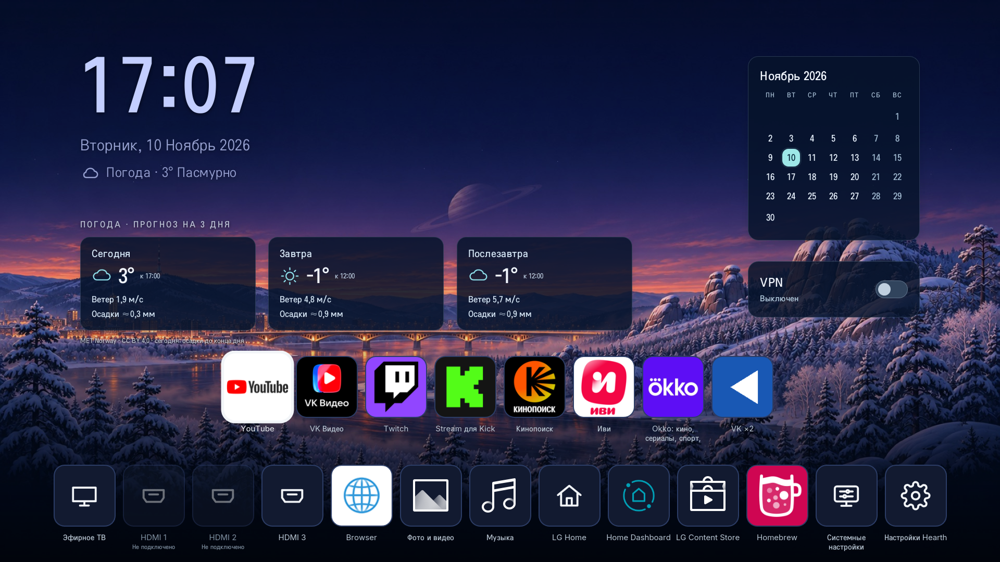

# webOS Home Kit

Главный экран и медиакомпоненты для LG webOS: Hearth с виджетами и сезонными фонами, клиенты Kick и VK ×2, управление VPN. Компоненты устанавливаются и сопровождаются отдельно.

## Возможности

| Компонент | Назначение |
|---|---|
| [Hearth](components/hearth) | Два ряда приложений, часы в 24-часовом формате, календарь, погода на 3 дня, фон по сезону и освещению |
| [Kick](components/kick) | Онлайн-каналы, поиск, избранное, записи и ускоренное воспроизведение |
| [VK ×2](components/vk-speed) | Отдельный плеер: скорость до 2×, качество 144p–4K/авто, переход ко времени |
| [VPN](components/vpn) | Выбор движка, состояние соединения и переключатель на Home |
| [Система](components/system) | Home→Hearth, обычный LiveTV при включении и управление аудио при переходах |

Управление рассчитано на пульт. Kick и VK используют независимые плееры; магазинное приложение VK остаётся без изменений. Локация погоды и VPN-сервер задаются при настройке.

## Начало работы

[Установка](docs/INSTALL.md) → [Настройка](docs/CONFIGURATION.md). Устройство компонентов описано в [архитектуре](docs/ARCHITECTURE.md), работа с исходниками — в [руководстве разработчика](docs/DEVELOPMENT.md).

`components/` содержит код и ресурсы, `settings/` — примеры настроек, `inventory/` — карту размещения и закреплённые источники. [Сторонние компоненты и лицензии](THIRD_PARTY.md).
