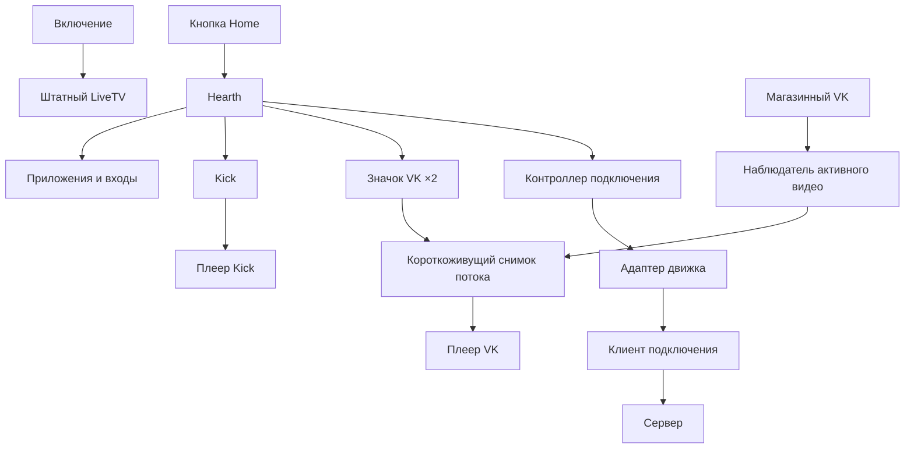

# Архитектура

## Главный экран

Hearth объединяет установленные приложения, входы ТВ и системные ярлыки. Пользовательские приложения и системные инструменты расположены в отдельных рядах; порядок пользовательских приложений читается из штатного launcher. Дополнительный dashboard отвечает за календарь, прогноз и выбор фона. UI подключения обращается к отдельному локальному контроллеру.

## Воспроизведение

Kick состоит из web-приложения, jailed service и собственного native-плеера. Для ускоренных записей service создаёт сессию и вызывает root-private helper. Обычное воспроизведение остаётся в основном клиенте.

VK observer читает медиасостояние только активного приложения VK. Проверенный URL и позиция хранятся кратковременно; launcher передаёт их отдельному плееру. Позиция просмотра из VK ×2 обратно в VK не записывается. Поддерживаются HLS и прямые MP4 с проверкой MIME/ftyp; MSE не используется.

У плееров отдельные app ID, профили, input shims и процессы. Общий ресурс — установленный CBE-движок LG, подключаемый read-only в собственные jail. HTTP-сессии привязаны к loopback, ограничены случайным идентификатором и UID клиента. Input bridge проверяет peer identity; потеря связи снимает собственный перехват клавиш. Завершение сессии закрывает плеер и его управляющие ресурсы.

## Подключение и система

Hearth обращается к общему контроллеру через root-only Unix-сокет. Контроллер хранит желаемое состояние, упорядочивает команды и возвращает стабильную модель статуса. Выбранный адаптер отвечает за daemon, авторизацию, маршруты, DNS и проверку работоспособности. UI не знает команд или формата настроек конкретного клиента.

Реестр допускает только явно подключённые адаптеры. Смена движка выполняется после отключения прежнего и завершения очистки; контроллер не допускает запуск второго поверх активного первого. [Контракт адаптера](../components/connection/ADAPTERS.md) определяет границу расширения.

System-компонент связывает Home с Hearth, управляет аудио-переходами и lifecycle собственных служб. Эти hooks не связаны с выбором медиапотоков. Порядок установки и требования к доступу находятся в [INSTALL.md](INSTALL.md).
